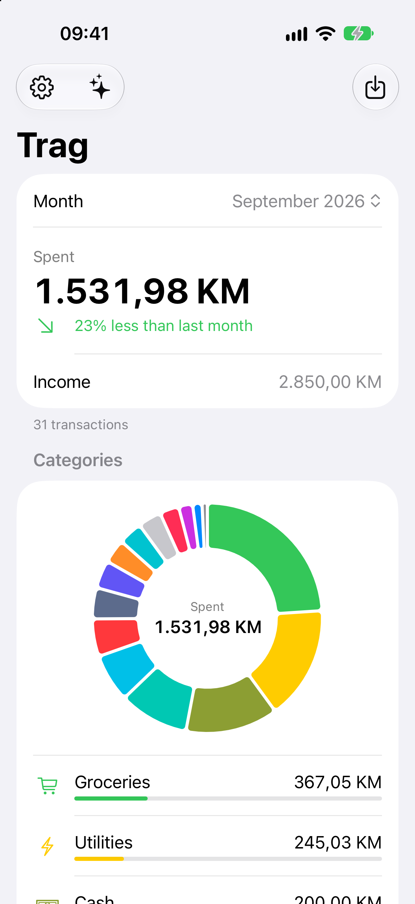
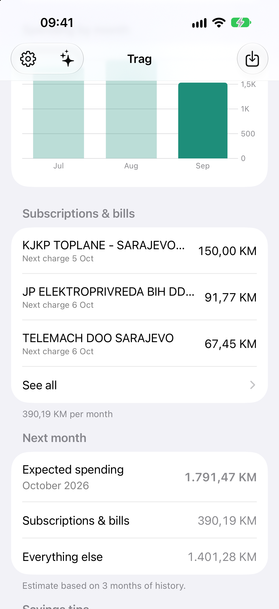
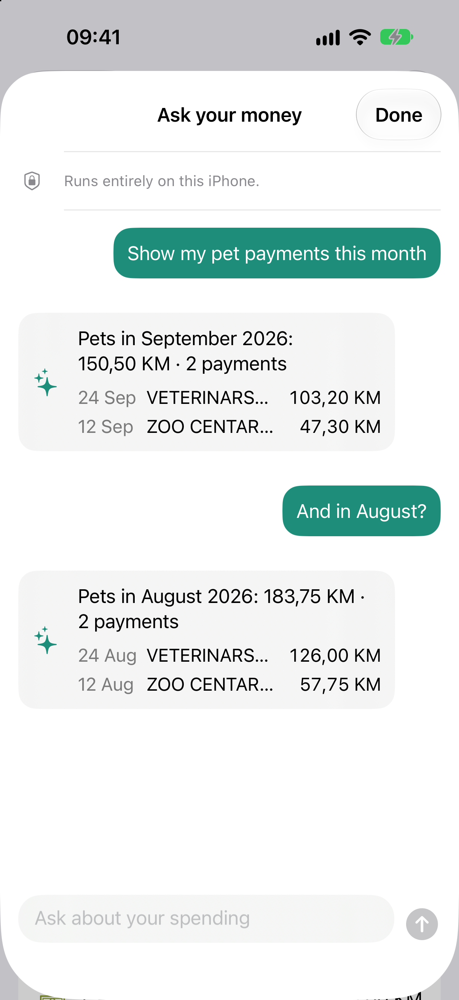
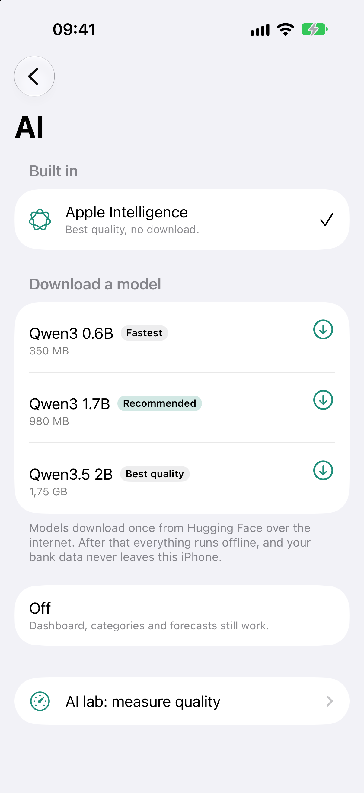
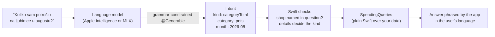
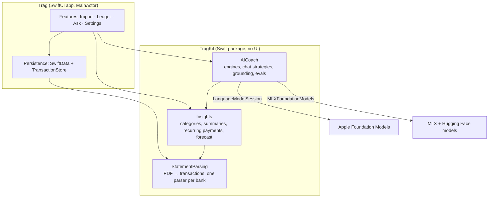

# Trag

**A private money coach for iPhone.** Import a bank statement and see where your money goes, what you pay every month, and what next month will cost. Ask questions in plain language, in English or Bosnian. Everything runs on the phone: your bank data never leaves it.

*Trag* is Bosnian for "trace": the trace your money leaves.

<p align="center">
  
  
  
  
</p>

## Highlights

- **Reads real bank statements.** A position-aware PDF parser for Union banka (Bosnia and Herzegovina) statements, validated against the totals printed on each statement, including rows split across pages.
- **Insights in plain Swift.** Spending by category and shop, month-over-month change, subscriptions and bills detected automatically (even foreign-currency ones whose local price moves with the exchange rate), and a next-month estimate.
- **On-device AI that can't invent numbers.** Categories for unknown shops, savings tips, and an "Ask your money" chat with totals, lists of payments and follow-up questions. Every amount the user sees is computed in Swift.
- **Choose your AI engine.** Apple Intelligence, or an open model (Qwen3 0.6B, Qwen3 1.7B, Qwen3.5 2B) downloaded in the app and run with MLX, so older iPhones get AI too. The same code path runs on both.
- **Measured, not guessed.** A shared eval suite scores every engine and strategy, on a Mac in tests and on the phone in an in-app AI lab.
- **Built to a bar.** Swift 6 strict concurrency, modular Swift packages, 95 tests, English and Bosnian localization with proper plurals, accessibility, light and dark mode, and a quality gate that fails on any warning.

Try it without a bank statement: tap **Try with demo data** on the first screen.

## How the AI stays honest

Small language models are good at understanding a question and bad at arithmetic. Trag never lets a model produce a number the user sees.



- **Structured intent (default).** The model only fills in a typed form (what kind of question, which category, shop and month) using constrained decoding. Swift verifies it, computes the answer and phrases it through the String Catalog, so answers are in Bosnian even though the on-device models don't speak it.
- **Tool calling (for comparison).** The model calls Trag's tools and writes the answer itself; a `GroundingCheck` withholds any answer containing an amount the tools didn't return.
- **Robustness from evals.** The evals found real failure modes, now handled in Swift: models skip optional fields under constrained decoding (all fields are required), copy shop names from the prompt's examples (a shop must appear in the question), and Bosnian changes word endings ("u Bingu" still finds Bingo). Extraction decodes greedily, so runs are reproducible.

### Eval results

Apple Intelligence on a Mac, synthetic data (`./scripts/ai-evals.sh`):

| Strategy | Categories | Chat: totals, lists, follow-ups (9 cases) | Savings tips |
|---|---|---|---|
| Tool calling | 10/10 | 7–8/9 · 2.5 s | 3/3 |
| **Structured intent** (default) | 10/10 | **9/9 every run** · 1.2 s | 3/3 |

Structured intent was more reliable even on Apple's model, about twice as fast, and lets the app answer in the user's language, so it is the default for every engine. Downloaded models are scored on the phone in the AI lab.

## Architecture



- **All logic lives in `TragKit`**, pure and tested; the app target is a thin SwiftUI layer with one `@Observable` model per feature.
- **Swift does the math.** Money is `Decimal`; models only see exact, Swift-computed text.
- **Each bank is a `StatementParser`** behind a registry; adding a bank never touches the rest of the app.
- **AI is optional at runtime.** Every screen works without it and explains why it's unavailable.

```
Trag/                 SwiftUI app: App/, Features/{Import,Ledger,Ask,Settings}/, Persistence/, Shared/, Resources/
TragKit/              Swift package: StatementParsing/, Insights/, AICoach/ (+ tests and AI evals)
TragTests/            app tests
docs/                 quality bar, bank format notes, screenshots
scripts/              check.sh (quality gate), format.sh, ai-evals.sh, check-localization.py
```

## Privacy

- No accounts, no servers, no analytics. The privacy manifest declares no data collection.
- The only network access is a model download the user starts, from pinned Hugging Face repositories.
- Logs never contain amounts, names or account numbers.
- Real statements used in development are git-ignored; tests use sanitized fixtures and generated demo data.

## Localization

English and Bosnian through a String Catalog, including Bosnian plural forms (1 transakcija, 2 transakcije, 5 transakcija). Money, dates and months follow the user's locale. `scripts/check-localization.py` fails the build on any missing or untranslated string.

<p align="center">
  
</p>

## Building and testing

Requirements: Xcode 27 with the Metal Toolchain component (Xcode › Settings › Components), iOS 27.

```bash
open Trag.xcodeproj        # trust the pinned mlx-swift-lm macros once when asked
./scripts/check.sh         # format lint, package tests, app build + tests, localization; warnings are errors
./scripts/ai-evals.sh      # score Apple Intelligence (needs a Mac with Apple Intelligence on)
```

MLX compiles Metal shaders, so builds go through Xcode or `xcodebuild` (not `swift build`). Dependencies are pinned to exact versions. The full quality bar is in [docs/QUALITY.md](docs/QUALITY.md).

## Adding a bank

1. Write format notes in `docs/<bank>-format.md`.
2. Implement `StatementParser` in `TragKit/Sources/StatementParsing/Banks/` and register it in `StatementParserRegistry`.
3. Add interpreter tests with sanitized rows. Real statements go in `test-data/private/` (git-ignored) and are checked automatically against their printed totals.

## Roadmap

- Scores for the downloadable models on a real iPhone 13
- More banks (Raiffeisen, UniCredit, Sparkasse) and CSV import
- Budgets and goals

---

Built by **Edhem Silajdzic**, senior mobile engineer. [LinkedIn](https://www.linkedin.com/in/edhemsilajdzic/) · [GitHub](https://github.com/silajdzice)
